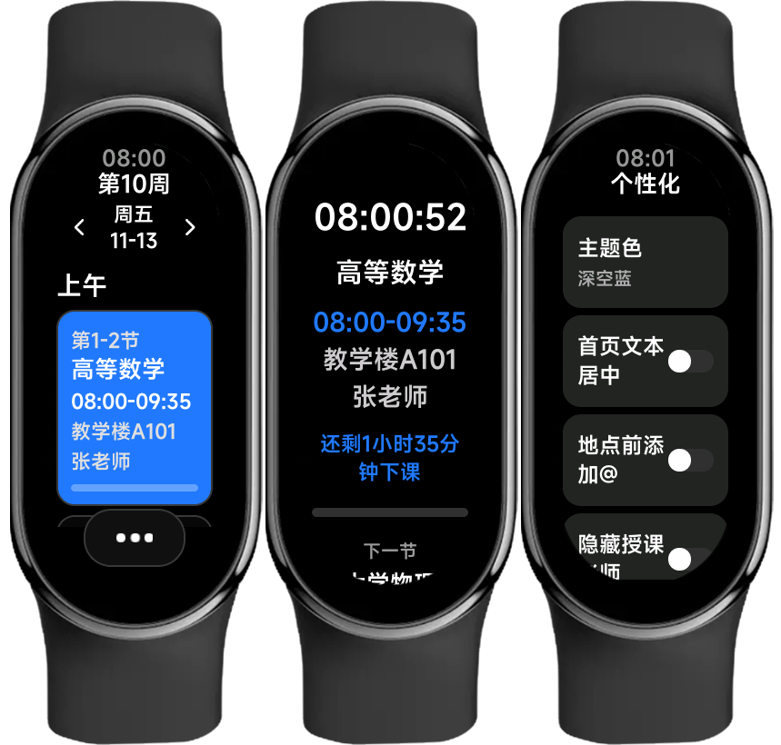
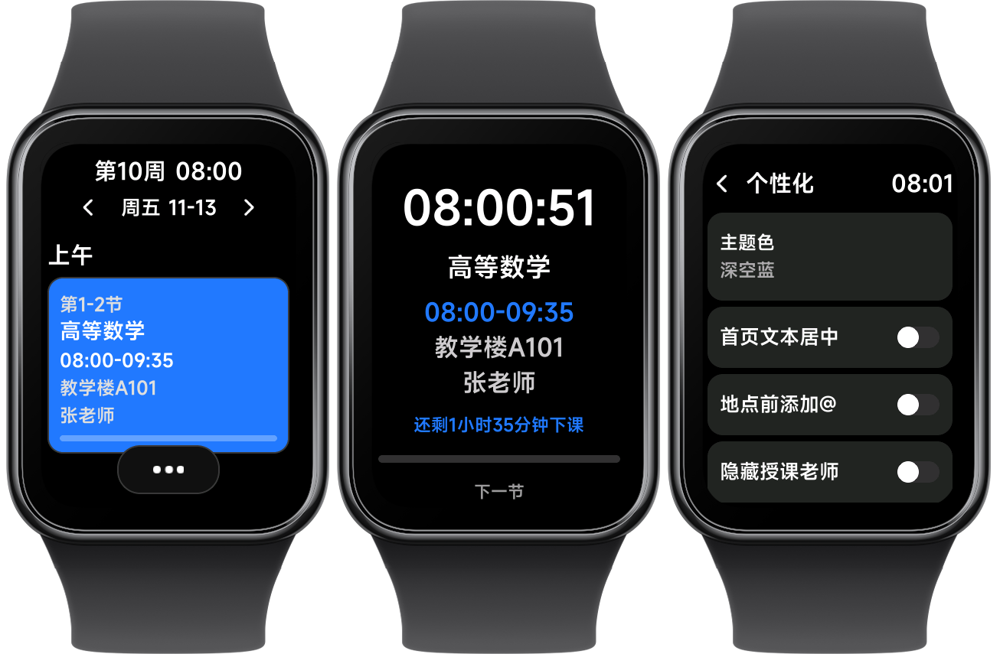

# HyperSchedule for Band

HyperSchedule 手环端快应用，适用于 Xiaomi Vela OS

> [!important]
> 为适配新开发的 Android 端应用，本快应用已修改包名，只能重新安装

## ✨ 功能特性
- 首页课程卡片支持显示节次、名称、时间、地点、教师
- 每日课程按时段分隔显示
- 用主题色高亮正在进行的课程卡片，已结束课程文字变暗
- 可切换上/下一天课程，点击日期回到今日
- 点击课程卡片进入详情页，显示当前时间、课程信息并支持显示备注
- 课程卡片与详情页支持显示上/下课倒计时和进度条
- 上课时详情页显示下一节课课程名称和地点
- 支持首页文本居中、地点前添加@、隐藏授课老师、隐藏备注等偏好
- 支持多种预设主题色

## 🖼️ 预览图

| Xiaomi-Band | Xiaomi-Band-Pro |
| - | - |
|  |  |

## 📥 安装方式

[](https://astrobox.online/open?source=resv2&id=com.schedule.vela&provider=OfficialV2)

> [!note]
> 课表依赖 [Android 端应用](https://github.com/Jursin/HyperSchedule/releases/latest) 推送

## 💻 开发
- 环境：Node.js
- 安装依赖
  ```
  npm install
  ```
- 首次开发：初始化示例课表
  ```
  cp examples/example-schedule.example.json examples/example-schedule.json
  ```
- 代码检查与格式化
  ```
  npm run lint   # eslint 检查并自动修复
  npm run format # prettier 一键格式化
  npm run check  # prettier 格式检查
  ```
- 调试
  ```
  npm run start
  ```
- 构建
  ```
  npm run build
  ```
- 发布
  ```
  npm run release
  ```

## 🤔 常见问题
### 为什么没有编辑课表功能？
手环屏幕小，操作不方便，且手机端编辑好后导入更高效，所以不考虑实现。

### 为什么不能放在首页小组件页面？
官方没开放实现方式，我也没办法。

### 可以适配其它设备吗？
在其它支持的设备上你仍可以尝试安装，但只在小米手环 9 实机测试过，其它部分设备界面上可能会有部分差异。个人精力有限，也没有更多设备测试，故不会主动适配更多设备。

## 📦 相关仓库
- Android 端应用：[Jursin/HyperSchedule](https://github.com/Jursin/HyperSchedule)

## 📖 参考
- [Xiaomi Vela JS 应用开发文档](https://iot.mi.com/vela/quickapp)

## 📄 许可证

本项目采用 [GPL-3.0](LICENSE) 许可证
